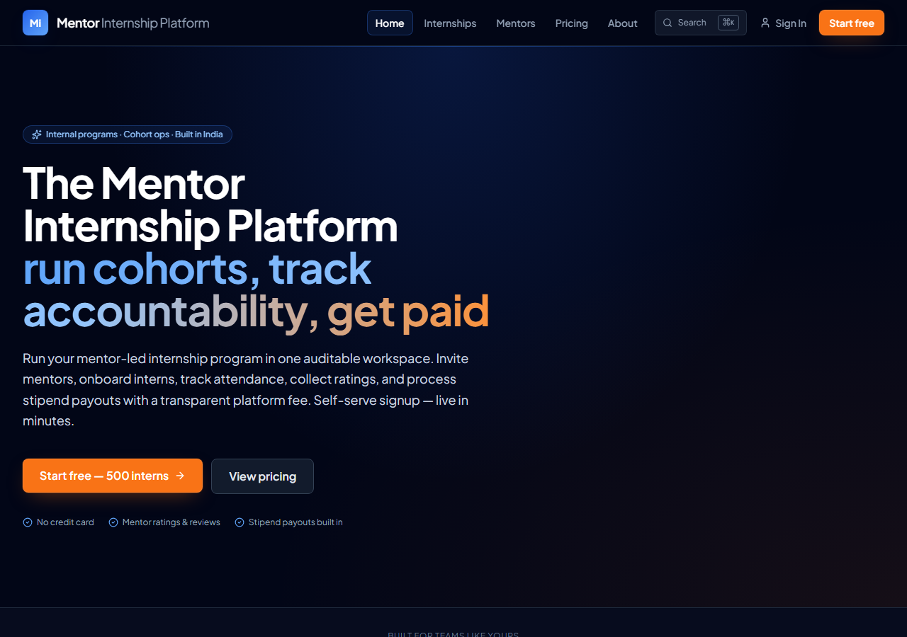
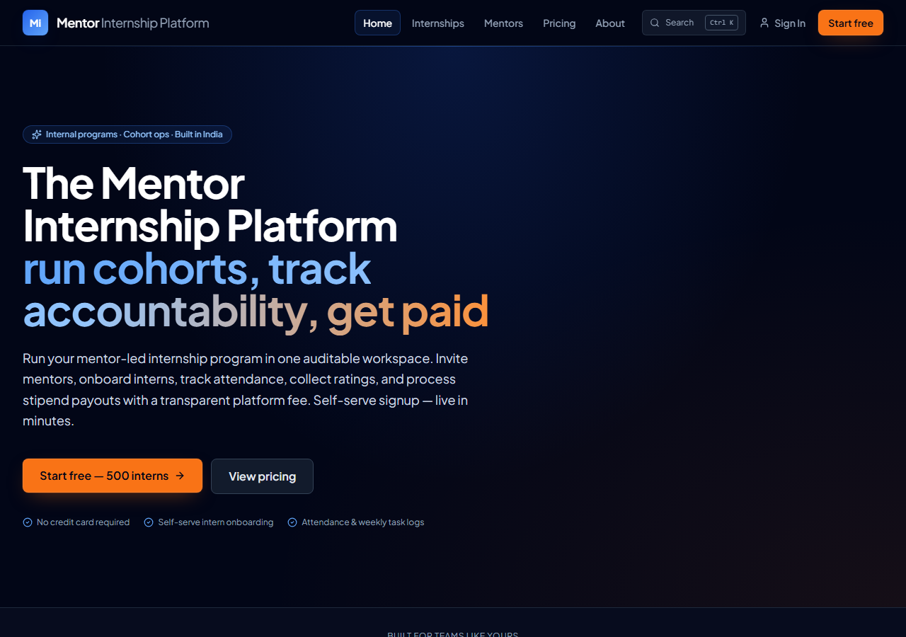
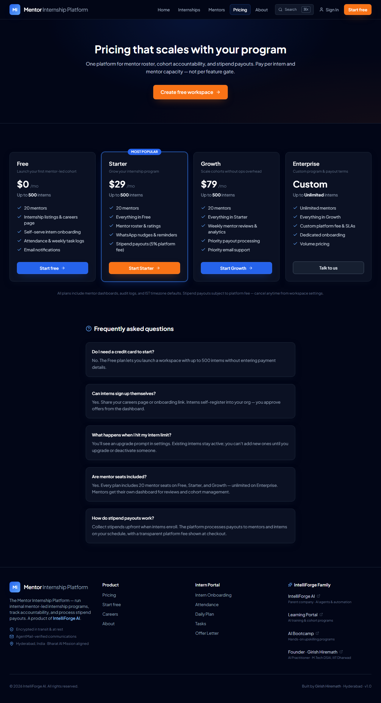
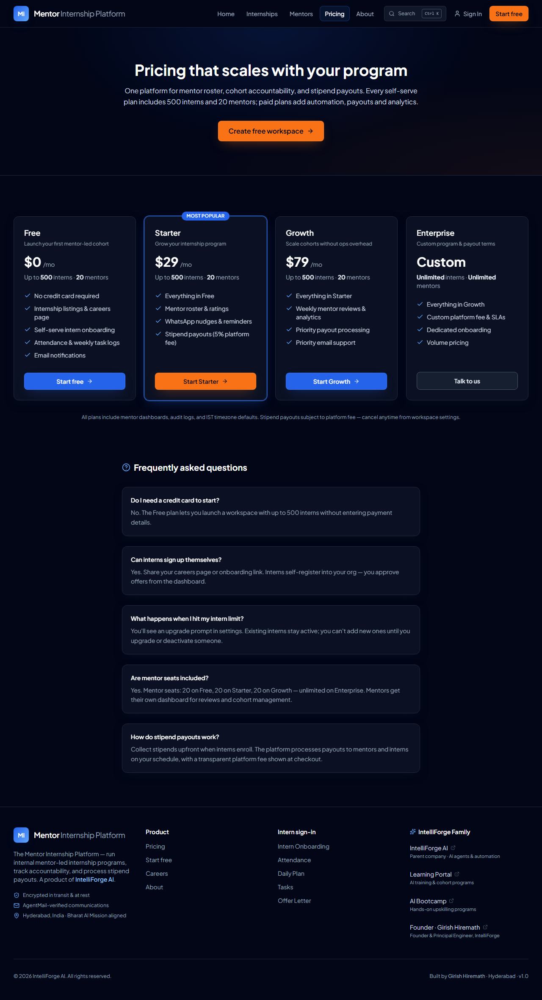
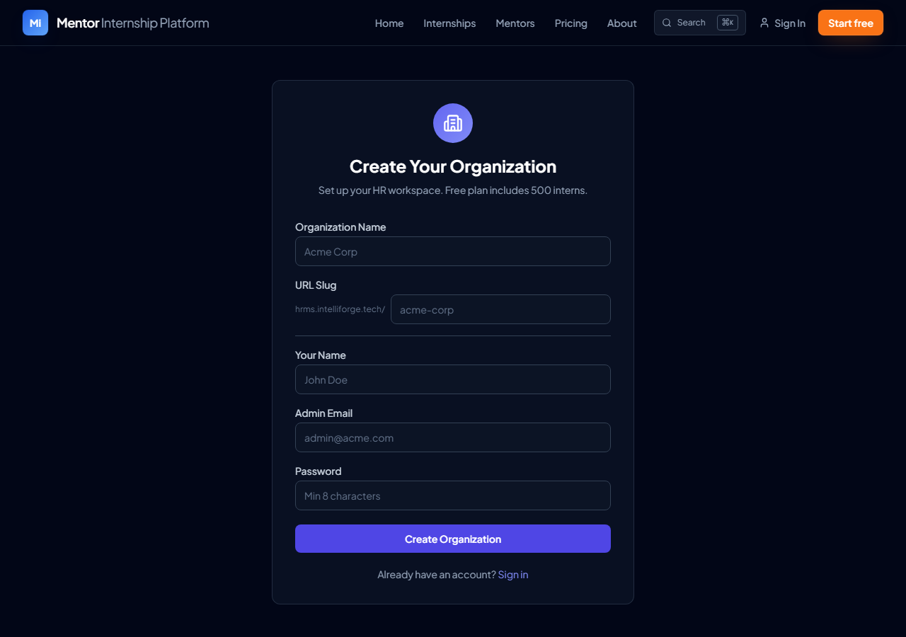
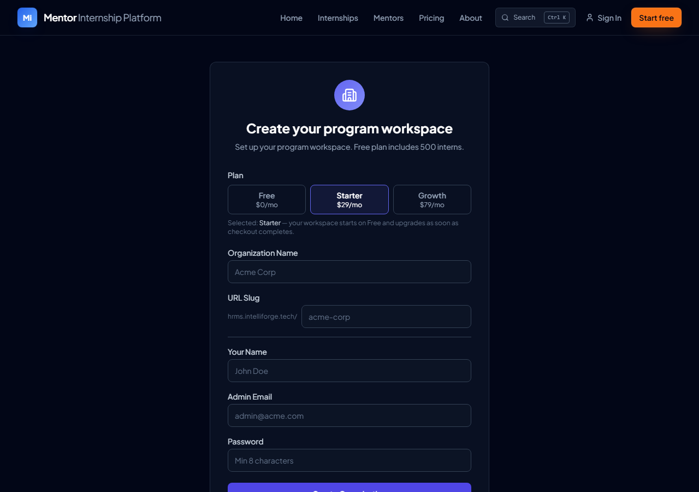
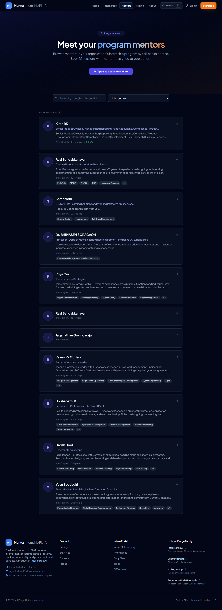
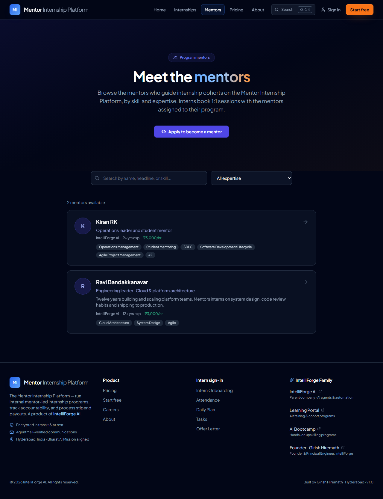

# QA fix handover — 09/11/2026

Branch `fix/qa-2026-11-09`. One commit per defect (`fix(Dn): …`); D4 and D7 each have one follow-up commit (the not-found screens and a hero layout fix found during verification). Plus `fix(qa): …` commits for the extra observations and a `test(qa): …` commit for the regression suite. The repo map written before any fix is in [REPO_MAP.md](REPO_MAP.md).

**No production data was read or changed.** Everything ran against a throwaway local Postgres in Docker, built the same way CI builds its database (`prisma db push` + `prisma/seed.mjs`), with the QA data recreated by `scripts/qa-fix/seed-qa-fixtures.mjs`. The `.env` in the main checkout points at what looks like the production Neon branch, so it was never loaded.

## 1. Defects

| ID | Status | Main files | How to verify |
|---|---|---|---|
| D1 plan limits | **Fixed** (limits kept equal: Q1) | `src/lib/plans.ts` (Zod-validated `PLANS`), `src/lib/pricing.ts`, `src/lib/plan-limits.ts`, `src/lib/stripe.ts`, `api/org`, pricing page/section, layout meta | `grep -rn "20 mentor\|500 intern" src` finds nothing outside `plans.ts`. Change `interns`/`mentors` in `PLANS` → cards, FAQ, meta, create-org and enforcement all follow. While limits are equal the copy no longer says "pay per capacity" / "more seats" (`pricingCopy()`). |
| D2 plan in CTAs | **Fixed** | `pricing-section.tsx`, `create-org/page.tsx`, `api/org/route.ts`, webhook `stripe`, migration `20261109120000_org_requested_plan` | `/pricing` → Start Starter → `/create-org?plan=starter`, Starter preselected. A paid choice is stored in `Organization.requestedPlan`; after creation the user goes to the existing Stripe checkout, or (billing not configured) to settings with a "plan activates once billing is set up" note. |
| D3 hero claims | **Fixed** | `plans.ts` (`hero: true` features), `page.tsx` | Hero bullets now come from Free features only. |
| D4 metadata / SSR | **Fixed** | `internships/[slug]/page.tsx` + `internship-detail.tsx`, `mentors/[slug]/page.tsx` + `mentor-detail.tsx`, `src/lib/public-listings.ts`, `sitemap.ts`, layouts for sign-in/create-org, `not-found.tsx` files | `curl -s <url> \| grep -o '<title>.*</title>'` is unique per route; listing description is in raw HTML; unknown slugs return 404; `/sitemap.xml` lists listings and public mentors. |
| D5 mentor data | **Fixed in code; data report only** | `src/lib/mentor-listing.ts`, mentor save routes, `mentor-card.tsx`, dashboard mentor-profile, `scripts/qa-fix/mentor-audit.ts` | Directory shows only complete profiles (headline + bio + ≥1 tag); one Ravi, no empty cards; rates show `₹5,000/hr`. Owner sees "Complete your profile". |
| D6 tags | **Fixed in code; backfill not run** | `src/lib/tag-normalise.ts`, `src/lib/tag-aliases.ts`, mentor save routes, `/mentors` + `/api/mentors`, `scripts/qa-fix/normalise-tags.ts` | Filter shows no `;`-joined tags or alias pairs, even before the backfill. Cards split joined tags, but still show both alias spellings (e.g. "SDLC" and "Software Development Lifecycle") until `normalise-tags.ts --canonical --execute` runs. |
| D7 hero separator | **Fixed** | `page.tsx` | h1 text reads "The Mentor Internship Platform: run cohorts, …"; visual unchanged. |
| D8 dead-end CTAs | **Fixed** (address is Q3) | `demo-video.tsx`, `social-proof.tsx`, `page.tsx` | No video exists, so the card says "See how it works" and jumps to features; design partner opens a mailto with subject "Design partner — Mentor Internship Platform". |
| D9 founder/contact | **Fixed, blocked on Q3 before merge** | `src/lib/site.ts`, about, layout (meta + JSON-LD), footer, sign-in, command palette, pricing, navbar | Title "Founder & Principal Engineer, IntelliForge"; no Gmail on any public page. |
| D10 naming / logo | **Fixed** | `PRODUCT_NAME` in `site.ts`; portal layouts, sign-in/up, reset, invite, 404, install prompt, auth + intern emails, `brand-mark.tsx` | Logo link's accessible name is "Mentor Internship Platform"; create-org says "program workspace". |
| D11 listings | **Partial** — see note | `src/lib/hiring/listing-display.ts`, `internships/page.tsx`, detail, `api/jobs`, migration `20261109130000_job_previous_slugs`, `scripts/qa-fix/regenerate-job-slugs.ts` | Old slugs 308 to the new one; type badge + type filter; "Stipend + PPO Potential · amount not disclosed" / "Stipend not disclosed". |
| D12 stat | **Fixed** | `page.tsx` | "Interns onboarded: 500+". |
| D13 currency | **Fixed shape; display blocked on Q2** | `plans.ts` (`priceMonthly: { USD, INR? }` minor units, `DISPLAY_CURRENCY`), `pricing.ts` | Still USD. Setting `DISPLAY_CURRENCY = "INR"` without INR amounts fails schema validation on purpose. |
| Intern portal copy | **Fixed** | `page.tsx` | "Sign in with your intern account". |
| Footer "Intern Portal" | **Fixed** (relabelled) | `footer.tsx` | Group is "Intern sign-in". |
| ⌘K vs Ctrl K | **Fixed** | `src/lib/use-shortcut-modifier.ts`, navbar, command palette | Shows Ctrl K off macOS. |
| `/mentors` copy | **Fixed** | `mentors/page.tsx`, `mentor-directory.tsx` | Written for anonymous visitors; empty state links to "Apply to become a mentor", not the dashboard. |
| Sign-in open redirect | **Fixed** | `src/lib/safe-redirect.ts`, sign-in, WhatsApp OTP form | `?redirect=//example.com`, `https://…`, `javascript:` → `/`. Middleware untouched. |
| Colour contrast (found by test 9) | **Fixed** | `globals.css` (`.btn-cta` text), public marketing components | axe: no serious/critical violations on `/`, `/pricing`, `/internships`, `/mentors` (production has 21–34 each). **Visible change:** orange CTA buttons now have dark text instead of white. |

**D11 note.** There is no endpoint or UI for editing a posting, so "regenerate the slug on edit" has nowhere to run yet. `slugChangeForTitle()` is the hook for that edit path when it exists; for existing postings the script applies it. The awaazos slug changes only when someone runs the script.

**D4 note.** The root `src/app/loading.tsx` made every page stream "Loading..." first. It moved to `src/components/route-loading.tsx` and is used only by `/weekly-progress`; dashboard and the other portal routes already had their own skeletons.

## 2. Open `// DECISION:` markers

| Q | Where | Current value |
|---|---|---|
| Q1 | `src/lib/plans.ts:130` (Starter), `src/lib/plans.ts:147` (Growth) | 500 interns / 20 mentors on Free, Starter and Growth. Changing them is one line each; the pricing copy switches to "capacity" wording automatically. Note the Stripe webhook writes these limits to the org on upgrade. |
| Q2 | `src/lib/plans.ts:25` (`DISPLAY_CURRENCY`) | `"USD"`. For INR, also add `INR` paise to Starter/Growth `priceMonthly`. Stripe prices are separate objects and would need INR prices too. |
| Q3 | `src/lib/site.ts:8` (founder link), `src/lib/site.ts:11` (contact email); used by `social-proof.tsx:4` and every `mailto()` | Proposed `https://girish-hiremath-profile.vercel.app` and `founder@intelliforge.tech`. **Check before merge:** intelliforge.tech's MX points at AgentMail, so founder@ must be an inbox someone reads or forwards. Otherwise Enterprise, Help and design-partner mail is "sent" and never seen. |
| Q4 | No code marker; handled by not touching data | Both Ravi profiles are kept. The empty one (`ravi-bandakkanavar-2pcl8a`) is hidden from the directory by the completeness rule. `mentor-audit.ts` reports the pair. |

## 3. Scripts (none were run against production)

All write paths are opt-in; the default is read-only. Run from the repo root with the target environment's env file.

| Script | Read-only / dry run | Apply |
|---|---|---|
| `scripts/qa-fix/mentor-audit.ts`: duplicate names, incomplete profiles, bio = headline | `npx tsx --env-file=.env.local scripts/qa-fix/mentor-audit.ts` (add `--json` for JSON) | Only bio clean-up: `… --fix-bios --execute`. Never merges or deletes. **Heads-up:** clearing Kiran RK's repeated bio leaves no bio, so the profile drops out of the directory until Kiran writes one. Consider asking Kiran first. |
| `scripts/qa-fix/normalise-tags.ts`: split/trim/de-dupe tags on profiles and applications | `npx tsx --env-file=.env.local scripts/qa-fix/normalise-tags.ts` (`--canonical` also applies aliases) | `… --execute` / `… --canonical --execute` |
| `scripts/qa-fix/regenerate-job-slugs.ts`: slugs that no longer match the title | `npx tsx --env-file=.env.local scripts/qa-fix/regenerate-job-slugs.ts` | `… --only=sales-associate-intern-awaazos --execute` (old slug kept in `previousSlugs`, so links redirect) |
| `scripts/qa-fix/seed-qa-fixtures.mjs`: recreates the QA mentors/listings | `node --env-file=.env.local scripts/qa-fix/seed-qa-fixtures.mjs` | `… --execute` (`--remove` to delete them). **Refuses any non-localhost `DATABASE_URL`.** |
| `scripts/qa-fix/axe-report.mjs`: serious/critical axe violations with contrast ratios | `node scripts/qa-fix/axe-report.mjs <baseUrl>` | — |
| `scripts/qa-fix/screenshots.mjs`: the before/after screenshots below | `node scripts/qa-fix/screenshots.mjs <label> <baseUrl>` | — |

Both migrations (`20261109120000_org_requested_plan`, `20261109130000_job_previous_slugs`) only add columns and an index, with no backfill. They run through `prisma migrate deploy` in the normal Vercel build.

## 4. Test results

The repo uses **npm**, not pnpm, so `npm test` / `npx playwright test` stand in for the pnpm commands in the brief.

- `npm run lint`: no warnings or errors.
- `npx tsc --noEmit`: clean.
- `npm test`: **23 files, 255 tests passed**.
- `npx next build`: succeeds.
- `npx playwright test tests/e2e/qa-regression.spec.ts` against the production build (`next build` + `next start`) on the seeded local DB with QA fixtures: **28/28 passed, none skipped**.
- Full `npx playwright test` against the same build: **280 passed, 5 failed, 7 skipped**. The 7 skips are existing tests that need optional credentials (daily plan, marketplace, tenant isolation, weekly progress). The 5 failures were existing specs asserting old copy or the old not-found screen. Four test expectations were updated; the fifth (mentor not-found) was a real regression from D4, fixed in code with segment `not-found.tsx` files. After those fixes, the QA suite plus the affected specs (auth, homepage, mentors, navigation, new-pages, internships) re-ran: **117 passed, 0 failed, 0 skipped**. The full suite was not re-run end to end after that last round.

New unit tests: `plans.test.ts` (PLANS schema, plan param, hero highlights, currency), `tag-normalise.test.ts`, `safe-redirect.test.ts`, `mentor-listing.test.ts`, `listing-display.test.ts`.

In CI the mentor checks (tests 7 and 8) skip because CI's seed has no mentor profiles. Run them locally after `seed-qa-fixtures.mjs`, or add that script to the CI seed step (it is localhost-only, so safe there).

## 5. Screenshots

Before = production on 09/11/2026. After = this branch on the local DB with QA fixtures.

| | Before | After |
|---|---|---|
| Home hero |  |  |
| Pricing |  |  |
| Create org (`?plan=starter`) |  |  |
| Mentors |  |  |

## 6. Found but not fixed (new defects)

| ID | Sev | Finding |
|---|---|---|
| D14 | S2 | Starter advertises "Stipend payouts (5% platform fee)", but `DEFAULT_PLATFORM_FEE_BPS` in `src/lib/plan-limits.ts` and the `Organization.platformFeeBps` default are 1000 (**10%**). One of them is wrong. |
| D15 | S3 | The hero paragraph under "Start free" still says "collect ratings, and process stipend payouts". It describes the product, not the Free plan, but sits right above the free CTA. |
| D16 | S3 | Stripe `success_url`/`cancel_url` fall back to `http://localhost:3000` when `NEXT_PUBLIC_APP_URL` is unset (`api/billing/checkout`). |
| D17 | S3 | The Stripe webhook writes `session.metadata.plan` to `Organization.plan` without validating it against `PLAN_KEYS`. The metadata is ours, so this is low risk, but `isPlanKey()` now exists for it. |
| D18 | S4 | The paid plans add no capacity today (Q1), so the dashboard "Upgrade" button sells features only. Fine if intended; it matters if Q1 lands on "limits". |
| D19 | S4 | `sendNewMentorApplicationAlert()` still sends to the HR inbox itself (already noted in CLAUDE.md). |
| D20 | S4 | Dashboard pages still use `text-slate-500` muted text that fails AA contrast; only the public pages were fixed here. |
| D21 | S4 | `next start` warns that it does not support `output: "standalone"`; use `node .next/standalone/server.js` for local production runs. |

Also for review: D10 changed one word in the founder's own testimonial (`social-proof.tsx`: "We built HRMS because…" → "We built this platform because…").
